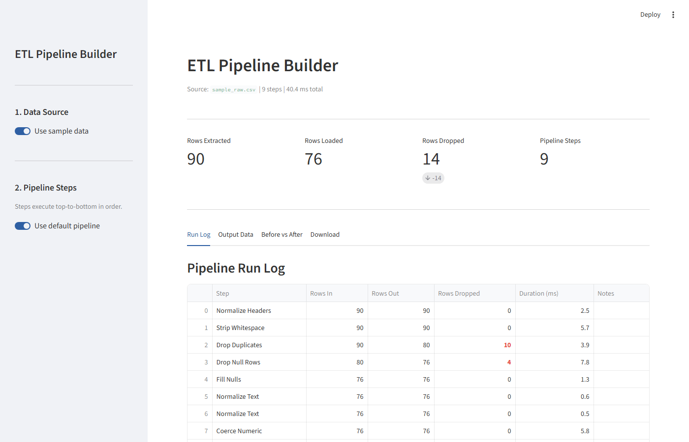
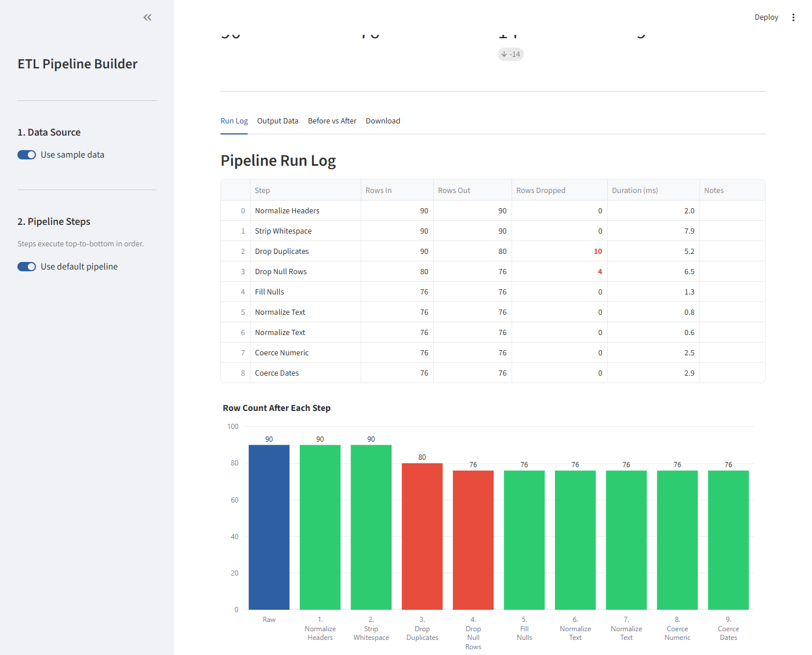
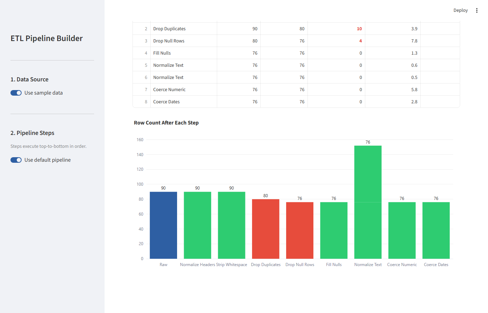

# ETL Pipeline Builder

[](https://www.python.org/)
[](LICENSE)
[](tests/)
[](https://github.com/RichieGarafola/etl-pipeline-builder/actions/workflows/tests.yml)
[](https://streamlit.io/)

A configurable Extract → Transform → Load pipeline that processes raw CSV data through named, ordered transformation steps and produces a cleaned, analysis-ready output with a full per-step audit trail.

---

## Business Problem

Data extracted from government financial tracking systems, contract registers, and procurement databases arrives with data quality issues that resist direct analysis: dates formatted as `10/21/2024`, `01-23-2025`, and `2024-05-25` in the same column; contract values as `$2,278,286`, `3,952,827`, and `500000` in the same field; vendor names with leading whitespace; status columns cycling through `ACTIVE`, `Active`, and `active` across the same dataset. Cleaning this data with one-off Excel formulas or ad hoc scripts creates an undocumented, non-repeatable process — the same problems reappear with each new export cycle, and there is no record of what was changed or why.

The ETL Pipeline Builder replaces ad hoc cleanup with a named, ordered, and testable pipeline. Each of the ten transformation steps is independently configurable, executes as a pure function that never mutates its input, and produces a `StepResult` record showing its input row count, output row count, rows dropped, and execution time. The full run is assembled into a `PipelineResult` that drives both the Streamlit dashboard and a downloadable audit log CSV.

---

## Architecture

```
Input CSV (file upload, path, or bundled sample data)
         │
         ▼
┌──────────────────────────────────────────────────────┐
│  EXTRACT          src/extractor.py                   │
│  extract_csv()  — reads all columns as str dtype     │
└─────────────────────────┬────────────────────────────┘
                          │  raw DataFrame
                          ▼
┌──────────────────────────────────────────────────────┐
│  TRANSFORM        src/transformer.py                 │
│  TransformStep.run() × N steps (pure functions)      │
│  Each step: df_in → apply(df) → df_out + StepResult  │
└─────────────────────────┬────────────────────────────┘
                          │  cleaned DataFrame + step_log
                          ▼
┌──────────────────────────────────────────────────────┐
│  LOAD             src/loader.py                      │
│  load_csv() / load_excel() / load_sqlite_sql()       │
└─────────────────────────┬────────────────────────────┘
                          │
                          ▼
┌──────────────────────────────────────────────────────┐
│  PipelineResult   src/pipeline.py                    │
│  rows_extracted, rows_loaded, step_log, output_df    │
│  summary_df() → downloadable audit trail             │
└──────────────────────────────────────────────────────┘
```

See [docs/ARCHITECTURE.md](docs/ARCHITECTURE.md) for the Stage Reference, step dependency graph, and five design decisions with rationale.

---

## Key Features

| Feature | Description |
|---|---|
| **10 composable transform steps** | NormalizeHeaders, StripStrings, DropDuplicates, DropNullRows, FillNulls, NormalizeText, CoerceNumeric, CoerceDates, FilterRows, RenameColumns — each independently configured and tested |
| **Step-level audit trail** | Every step records rows in, rows out, rows dropped, and execution time in milliseconds; assembled into a downloadable `PipelineResult.summary_df()` |
| **Pure function steps** | Each `TransformStep.apply()` returns a copy of the DataFrame and never mutates the input — safe for composability and independent unit testing |
| **Three export formats** | CSV download, Excel (.xlsx via openpyxl), and portable SQL text dump (CREATE TABLE + INSERT via in-memory SQLite `iterdump()`) |
| **Downloadable audit log** | Step-by-step row count and timing exported as `etl_audit_log.csv` alongside the cleaned data |
| **CLI entry point** | `scripts/run_pipeline.py` enables batch automation via `--input` / `--output` / `--sqlite` / `--audit-log` without the Streamlit UI |
| **Default + custom pipeline** | Toggle between a pre-configured 9-step default pipeline and a custom step selector backed by `STEP_REGISTRY` |
| **Row count funnel chart** | Plotly bar chart showing row count after each step; blue for no drops, red for rows dropped |
| **Before vs. After comparison** | Side-by-side raw vs. transformed DataFrames with a null/empty count improvement table |

---

## Skills Demonstrated

| Skill | File | Function / Class | Description |
|---|---|---|---|
| Composable ETL step pattern — dataclass inheritance with abstract `apply()` and timing wrapper `run()` | `src/transformer.py` | `TransformStep` | Base dataclass; all 10 concrete steps override only `apply()`; `run()` adds perf_counter timing and returns `StepResult` |
| Per-step telemetry via `StepResult` dataclass | `src/transformer.py` | `StepResult` | `rows_in`, `rows_out`, `duration_ms`; `rows_dropped` computed property; produced by every `TransformStep.run()` |
| Pipeline audit trail via `PipelineResult.summary_df()` | `src/pipeline.py` | `PipelineResult.summary_df()` | Converts `step_log: list[StepResult]` to a 6-column DataFrame: Step, Rows In, Rows Out, Rows Dropped, Duration ms, Notes |
| Currency and comma-formatted string to float | `src/transformer.py` | `CoerceNumeric.apply()` | `str.replace(r"[\$,]", "", regex=True)` → `pd.to_numeric(errors="coerce")` |
| Mixed-format date normalization to ISO 8601 | `src/transformer.py` | `CoerceDates.apply()` | `pd.to_datetime(format="mixed", dayfirst=False)` → `.dt.strftime("%Y-%m-%d")`; NaN on failure |
| In-memory SQLite export via `iterdump()` — zero file I/O | `src/loader.py` | `load_sqlite_sql()` | `sqlite3.connect(":memory:")` → `df.to_sql()` → `"\n".join(conn.iterdump())` → UTF-8 BytesIO |
| `@st.cache_data` pipeline caching keyed on file bytes | `app/main.py` | `cached_run(file_bytes)` | Cache key is raw file bytes; `None` for sample data; cache invalidates on any content change |
| snake_case header normalization via multi-pass regex | `src/transformer.py` | `NormalizeHeaders.apply()` | `re.sub(r"[\s\-]+", "_")` → `re.sub(r"[^\w]", "")` → `.lower()` |
| Plotly Bar chart with conditional per-bar coloring | `app/main.py` | Run Log tab | `go.Bar` with per-bar color list: `BLUE` for no drops, `#E74C3C` for rows dropped; count labels outside bars |
| `STEP_REGISTRY` dict for UI-driven step class instantiation | `src/transformer.py` | `STEP_REGISTRY` | `dict[str, type[TransformStep]]`; sidebar multiselect lists keys; UI instantiates class by registry lookup |

---

## Tech Stack

| Component | Library |
|---|---|
| UI | Streamlit >= 1.32 |
| Data manipulation | pandas >= 2.0 |
| Visualization | Plotly >= 5.18 |
| Excel export | openpyxl >= 3.1 |
| SQL export | sqlite3 (standard library) |
| Tests | pytest >= 7.4 |

---

## Domain Context

Government contract registers and procurement tracking datasets are maintained in spreadsheets with no enforced schema. Column names vary between agencies (`"Contract ID"` vs `"ContractID"` vs `"contract_id"`), date formats follow regional conventions or the preference of whoever last edited the file, and monetary values carry currency symbols that prevent direct numeric analysis. This pipeline is calibrated for these conditions: the sample dataset represents a government contracts register with the data quality issues documented above, and the default pipeline resolves each issue through a named, testable transformation step.

The pipeline's explicit audit trail — rows in, rows out, rows dropped per step, execution time — supports data governance requirements in environments where data handling accountability and traceability are expected, including federal contractor data operations.

---

## Project Structure

```
etl-pipeline-builder/
├── app/
│   └── main.py                      # Streamlit UI — sidebar, tabs, downloads
├── src/
│   ├── __init__.py                  # Public API (22 exported symbols)
│   ├── extractor.py                 # Stage 1 — CSV extraction
│   ├── transformer.py               # Stage 2 — 10 TransformStep classes + STEP_REGISTRY
│   ├── loader.py                    # Stage 3 — CSV, Excel, SQLite load targets
│   ├── pipeline.py                  # Orchestration — PipelineResult, run_pipeline(), default_steps()
│   └── charts.py                    # Row-count chart builder (one bar per executed step)
├── data/
│   └── sample/
│       └── sample_raw.csv           # 90-row dirty government contracts dataset
├── docs/
│   ├── ARCHITECTURE.md              # Stage Reference, step dependency graph, 5 design decisions
│   ├── TESTING.md                   # 75-test inventory, per-class breakdown, known gaps
│   ├── DATA_DICTIONARY.md           # Input/output schemas, transformation catalog
│   └── ENGINEERING_DECISIONS.md     # Six engineering decisions with alternatives and rationale
├── screenshots/
│   ├── 01_overview.png              # Pipeline overview — KPI strip and step audit table
│   ├── 02_core_feature.png          # Run Log — step timing and row count funnel chart
│   └── 03_results.png               # Transformed output with row count summary
├── scripts/
│   ├── run_pipeline.py              # CLI entry point (--input, --output, --sqlite, --audit-log)
│   └── generate_sample_data.py      # Regenerates sample_raw.csv — development utility
├── tests/
│   ├── test_transformer.py          # 34 tests — all 10 step types
│   ├── test_pipeline.py             # 21 tests — pipeline orchestration
│   ├── test_extractor.py            # 6 tests  — extraction
│   ├── test_loader.py               # 8 tests  — CSV / Excel / SQLite load targets
│   └── test_charts.py               # 6 tests  — row-count chart regression
├── .streamlit/
│   └── config.toml                  # Portfolio standard theme
├── .github/
│   └── workflows/
│       └── tests.yml                # CI — Python 3.11, pytest on push and PR
├── requirements.txt
├── CHANGELOG.md
├── LICENSE
└── .gitignore
```

---

## Quick Start

**Prerequisites:** Python 3.11+

```bash
git clone https://github.com/RichieGarafola/etl-pipeline-builder.git
cd etl-pipeline-builder

python -m venv .venv

# Windows
.venv\Scripts\activate
# macOS / Linux
source .venv/bin/activate

pip install -r requirements.txt
```

---

## Usage

### Streamlit Interface

```bash
streamlit run app/main.py
```

The app opens at `http://localhost:8501`.

**Sample data:** The "Use sample data" toggle is enabled by default. The default 9-step pipeline runs automatically on load.

**Custom CSV:** Toggle off "Use sample data" and upload any CSV file. Toggle off "Use default pipeline" in the sidebar to select and reorder steps from the full step registry.

**Export results:** Navigate to the Download tab to export the cleaned data as CSV, Excel (.xlsx), or SQL dump. The Audit Log button exports the per-step row count and timing as a separate CSV.

---

### Command-Line Interface

Run the default pipeline on any CSV file:

```bash
python scripts/run_pipeline.py \
  --input  data/sample/sample_raw.csv \
  --output results/cleaned.csv
```

With optional SQLite database and audit log:

```bash
python scripts/run_pipeline.py \
  --input     data/sample/sample_raw.csv \
  --output    results/cleaned.csv \
  --sqlite    results/etl_output.db \
  --audit-log results/etl_audit_log.csv
```

**CLI output:**
```
ETL Pipeline Builder
  Input:  data/sample/sample_raw.csv
  Output: results/cleaned.csv

  Rows extracted : 90
  Rows loaded    : 74
  Rows dropped   : 16
  Duration       : 18.3 ms

  CSV saved      : results/cleaned.csv
Done.
```

**Programmatic use (Python):**

```python
from src import run_pipeline, default_steps, load_csv

result = run_pipeline(default_steps(), source_path="data/sample/sample_raw.csv")
print(result.summary_df())          # per-step audit trail
csv_bytes = load_csv(result.output_df)  # BytesIO CSV
```

---

## Sample Data

`data/sample/sample_raw.csv` is a 90-row synthetic government contracts dataset representing a procurement tracking register.

**Columns:** Contract ID, Agency Name, Vendor, Category, Contract Value, Start Date, End Date, Status, Award Year, Notes

**Intentional data quality issues resolved by the default pipeline:**

| Issue | Example Raw Value | Default Step That Resolves It |
|---|---|---|
| Mixed-case status values | `COMPLETED`, `Completed`, `completed` | NormalizeText (title case) |
| Currency-formatted values | `"$2,278,286"`, `"3,952,827"` | CoerceNumeric |
| Mixed date formats | `10/21/2024`, `2024-05-25`, `01-23-2025` | CoerceDates |
| Leading/trailing whitespace in vendor names | `"  Apex Federal Solutions  "` | StripStrings |
| Null and `"N/A"` notes fields | `""`, `NaN` | FillNulls |
| Duplicate rows | ~10 exact duplicate rows injected | DropDuplicates |
| Null agency names | ~8% of rows | DropNullRows |

---

## Testing

```bash
pytest tests/ -v
```

**75 tests** across 5 files:

| File | Tests | Coverage |
|---|---|---|
| `test_transformer.py` | 34 | All 10 step types: correct output values, immutability, edge cases, missing-column safety |
| `test_pipeline.py` | 21 | Pipeline orchestration, PipelineResult structure, row count consistency, error handling |
| `test_extractor.py` | 6 | Return type, column presence, string dtype, explicit path, empty file error |
| `test_loader.py` | 8 | CSV BytesIO + disk, SQLite SQL dump content, Excel BytesIO + disk |
| `test_charts.py` | 6 | Row-count chart: one bar per executed step, repeated step names kept separate, values match the audit trail |

No mocking of internal library functions. `TestRunPipeline` and `TestDefaultSteps` run the full pipeline against `data/sample/sample_raw.csv` as integration tests.

See [docs/TESTING.md](docs/TESTING.md) for the complete per-class breakdown and known gaps.

---

## Limitations

- **CSV input only.** The extractor reads CSV files. Excel, JSON, Parquet, and database sources are not supported without extending `src/extractor.py`.
- **Default pipeline parameters are code-only.** The UI lets you select which steps to include, but per-step parameters (which columns to coerce, which values to filter) use hardcoded defaults. Changing step parameters requires editing `default_steps()` in `src/pipeline.py`.
- **`CoerceDates` is month-first on ambiguous dates.** `format="mixed"` with `dayfirst=False` treats `01/02/2024` as January 2nd, not February 1st. Datasets with day-first date conventions require editing the `dayfirst` parameter in `CoerceDates.apply()`.
- **`FilterRows` uses substring matching, not exact equality.** A filter value of `"act"` matches both `"Active"` and `"Enacted"`. Use precise values or `RenameColumns` to normalize values before filtering.
- **No output schema validation.** The pipeline does not enforce that the cleaned DataFrame meets a target schema. Column presence and types after transformation are the caller's responsibility.

---

## Business Impact

1. **Repeatability.** The same pipeline applied to the same input always produces the same output. Ad hoc cleanup scripts tied to a particular session or analyst's judgment are replaced by a version-controlled, reproducible process.

2. **Accountability.** The per-step audit trail — rows in, rows out, rows dropped, execution time — makes every transformation accountable. A data steward or team lead can verify exactly what happened to a dataset without re-running or reverse-engineering the cleanup logic.

3. **Automation integration.** The CLI entry point (`scripts/run_pipeline.py`) enables this pipeline to run as part of a scheduled batch process, CI pipeline, or shell script without the Streamlit UI layer. The `--sqlite` and `--audit-log` flags allow integration with downstream database workflows.

---

## Roadmap

- **Per-step parameter UI controls** — sidebar expanders for each step allowing column selection, fill values, and filter lists to be configured without editing source code
- **Excel and JSON input support** — extend `src/extractor.py` to read `.xlsx` (via openpyxl) and `.json` (via `pd.read_json`) source files
- **Output schema validation** — configurable expected column names and types; fail the pipeline with a clear error if the output does not match the schema
- **Pipeline export/import as JSON config** — serialize the active step sequence and parameters to a JSON file so the same pipeline can be reproduced across sessions or shared with teammates
- **Database load targets** — PostgreSQL and DuckDB load functions in `src/loader.py` via optional dependencies

---

## Screenshots

| Overview | Core Feature | Results |
|---|---|---|
|  |  |  |
| KPI strip and step audit table | Step execution timing and row count funnel chart | Transformed output with row count summary |

---

## Documentation

| Document | Description |
|---|---|
| [docs/ARCHITECTURE.md](docs/ARCHITECTURE.md) | Stage Reference, step execution model, step dependency graph, design decisions with rationale |
| [docs/DATA_DICTIONARY.md](docs/DATA_DICTIONARY.md) | Input and output schemas, transformation catalog with before/after examples, export format specifications |
| [docs/TESTING.md](docs/TESTING.md) | 75-test inventory, per-class breakdown, known gaps, testing philosophy |
| [docs/ENGINEERING_DECISIONS.md](docs/ENGINEERING_DECISIONS.md) | Six engineering decisions with alternatives considered and rationale |

---

## License

MIT — see [LICENSE](LICENSE)
